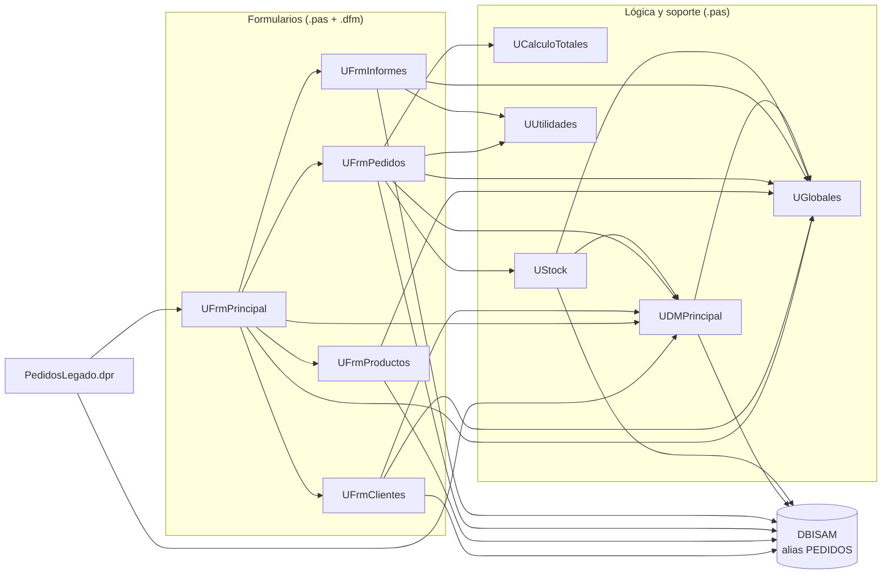

# Dependencias de Pedidos Legado

> Etapa 1 · Entender (T2 de `specs/TEC-03-diagnostico-legado/`). Una flecha `A --> B` significa «A usa a B»: sale de la cláusula `uses`
> de la unidad o de una consulta SQL / tabla que la unidad abre contra la base (alias `PEDIDOS`). Cada formulario es un par `.pas` + `.dfm`.
> Las unidades estándar de Delphi (`SysUtils`, `Forms`, `DB`, etc.) no se dibujan.

Lectura del diagrama: las flechas a `BD` son accesos directos a la base (tablas o consultas con `DatabaseName = 'PEDIDOS'` en el `.dfm`
o en el código). Solo `UDMPrincipal` debería hablar con la base, pero cuatro formularios y `UStock` también lo hacen por su cuenta.
`UCalculoTotales`, `UUtilidades` y `UGlobales` no tienen flechas de salida: no usan ninguna otra unidad del sistema.

## Preguntas guía

1. **¿Qué unidad usan casi todas las demás? ¿Qué pasaría si cambia?**
   `UGlobales`: la usan 7 de las 10 unidades (`UFrmPrincipal`, `UFrmClientes`, `UFrmProductos`, `UFrmPedidos`, `UFrmInformes`, `UStock`
   y `UDMPrincipal`). Le sigue `UDMPrincipal`, usada por 4 (`UFrmPrincipal`, `UFrmClientes`, `UFrmPedidos` y `UStock`). Como `UGlobales`
   guarda variables mutables compartidas (usuario, IVA, flete, folio, modo prueba), cambiar o renombrar una de ellas puede alterar el
   comportamiento de casi todo el sistema sin que el compilador lo avise; por eso conviene sacar esas variables de a una, no todas juntas.
2. **¿Qué unidad no depende de formularios ni de la base de datos? ¿Por qué eso importa para migrar?**
   `UCalculoTotales` (solo usa `SysUtils`) y `UUtilidades` (solo `SysUtils` y `DateUtils`). Son lógica pura: reciben números y devuelven
   números, así que se pueden migrar y probar sin tocar pantallas ni base de datos. Es el argumento para que el cálculo de totales sea la
   primera pieza de la Unidad 5, con una advertencia: el redondeo está duplicado entre `Calc3` (`UCalculoTotales.pas:48`) y `RedondeaPesos`
   (`UUtilidades.pas:28`) y hay que migrarlo una sola vez y con los mismos resultados.
